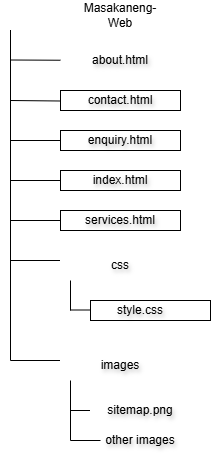

# Masakaneng Soup Kitchen Website

**Student:** Khomotso Mojela  
**Student Number:** ST10508982  
**Module:** WEDE5020

---

## Project Overview

Masakaneng Soup Kitchen is a community-based organisation that provides meals to vulnerable individuals and families. This website aims to raise awareness, attract volunteers, and facilitate donations.

---

## Website Goals and Objectives

- Raise awareness about food insecurity in the community
- Attract volunteers to support daily operations
- Accept donations (food and funds)
- Share upcoming events and community drives

**KPIs:**

- Increase volunteer sign-ups by 30% in 6 months
- Grow monthly donations by 20%
- Increase website traffic by 40%

---

## Key Features and Functionality

- Responsive navigation menu
- Hero section with call-to-action
- Enquiry/volunteer form
- Google Map integration
- Gallery of community work
- External CSS stylesheet (Part 2)
- Responsive design for desktop, tablet and mobile (Part 2)

---

## Timeline and Milestones

| Milestone                        | Date                    |
| -------------------------------- | ----------------------- |
| Part 1 (Planning & HTML)         | August 2026             |
| Part 2 (CSS & Responsive Design) | September 2026          |
| Part 3 (JavaScript & SEO)        | October - November 2026 |

---

## Part 1 Details

- Two project proposals submitted
- Content researched and gathered
- Sitemap created
- HTML structure built with 5 pages
- GitHub repository set up

---

## Part 2 Details

- External CSS stylesheet (`css/style.css`) created and linked to all pages
- Applied typography styles (font-family, font-size, font-weight, line-height, letter-spacing)
- Used Flexbox and CSS Grid for layout structure
- Applied visual styles (colour, background, border, box-shadow)
- Used pseudo-classes (`:hover`, `:focus`, `:active`) for interactive elements
- Used relative units (`rem`, `%`) for responsiveness
- Implemented responsive design with media queries for tablet (768px) and mobile (480px)
- Made all images responsive using `max-width: 100%` and `height: auto`

---

## Part 3 Details

- Added JavaScript interactivity using a separate `js/script.js` file
- Implemented a dynamic search filter on the Services page to sort/filter service cards
- Created an interactive Image Lightbox that opens images in a larger overlay across all pages
- Added JavaScript form validation on the Contact page (checks for a 10-digit phone number and minimum message length)
- Implemented dynamic form calculations on the Enquiry page (generates specific responses based on user selection)
- Added an interactive FAQ Accordion on the Services page
- Added interactive Tabs on the About page (switching between History, Mission, and Vision)
- Implemented a "Back to Top" button with smooth scrolling
- Added SEO best practices: descriptive title tags, meta descriptions, keywords, and image alt text
- Created a `robots.txt` file to instruct search engine crawlers
- Created a `sitemap.xml` file to map out the website structure for search engines
- Deployed the final website live using GitHub Pages

---

## Sitemap

---

## Changelog

- **12/08/2026:** Initial README created. HTML structure added.
- **16/09/2026:** Added external CSS stylesheet (`style.css`) with base styles, typography, Flexbox, CSS Grid, pseudo-classes and visual styles.
- **16/09/2026:** Implemented responsive design with media queries for tablet and mobile.
- **16/09/2026:** Made images responsive across all pages.
- **16/09/2026:** Updated README with Part 2 details and changelog entries.
- **21/10/2026:** Part 3 - Added JavaScript search filter, image lightbox, form validation, dynamic enquiry calculations, FAQ accordion, tabs, and back-to-top button.
- **22/10/2026:** Part 3 - Added SEO meta tags, `robots.txt`,`sitemap.xml`, Tap Functionality.
- **23/10/2026:** Deployed the final website to GitHub Pages.

---

## References

GitHub Docs, 2026. _Getting started with GitHub Pages_. [online] Available at: <https://docs.github.com/en/pages> [Accessed 23 October 2026].

Google, 2026. _Search Engine Optimization (SEO) Starter Guide_. [online] Available at: <https://developers.google.com/search/docs/fundamentals/seo-starter-guide> [Accessed 23 October 2026].

Masakaneng Soup Kitchen, 2026. _Masakaneng Soup Kitchen_ [Facebook page]. Available at: <https://www.facebook.com/profile.php?id=61560964268377> [Accessed 12 August 2026].

MDN Web Docs, 2026. _JavaScript Guide_. [online] Available at: <https://developer.mozilla.org/en-US/docs/Web/JavaScript> [Accessed 23 October 2026].

MDN Web Docs, 2026. _Client-side form validation_. [online] Available at: <https://developer.mozilla.org/en-US/docs/Learn/Forms/Form_validation> [Accessed 23 October 2026].

W3Schools, 2026. _CSS Tutorial_. Available at: <https://www.w3schools.com/css/> [Accessed 16 September 2026].

W3Schools, 2026. _HTML Tutorial_. Available at: <https://www.w3schools.com/html/> [Accessed 12 August 2026].

W3Schools, 2026. _JavaScript Tutorial_. Available at: <https://www.w3schools.com/js/> [Accessed 23 October 2026].
